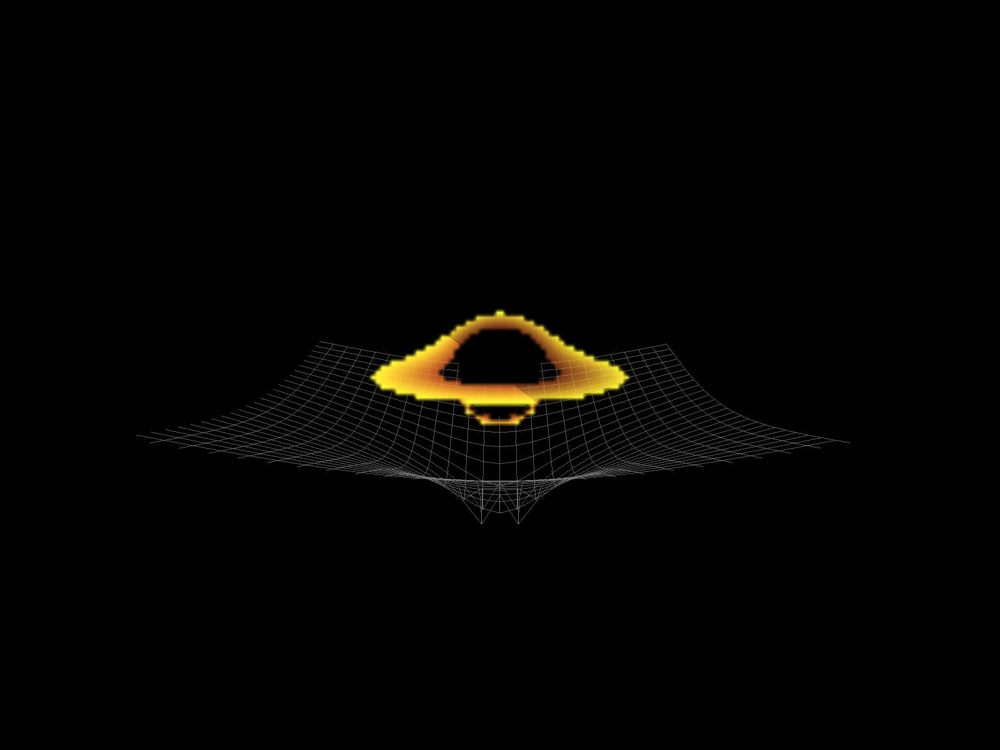

# **black**_**hole**

Black hole simulation project

Here is the black hole raw code, everything will be inside a src bin incase you want to copy the files

I'm writing this as I'm beginning this project (hopefully I complete it ;D) here is what I plan to do:

1. Ray-tracing : add ray tracing to the gravity simulation to simulate gravitational lensing

2. Accretion disk : simulate accreciate disk using the ray tracing + the halos

3. Spacetime curvature : demonstrate visually the "trapdoor in spacetime" that is black holes using spacetime grid

4. [optional] try to make it run realtime ;D

I hope it works :/

Edit: After completion of project -

## **Building Requirements:**

1. C++ Compiler supporting C++ 17 or newer

2. [Cmake](https://cmake.org/)

3. [Vcpkg](https://vcpkg.io/en/)

4. [Git](https://git-scm.com/)

## **Build Instructions:**

1. Clone the repository:
	-  `git clone https://github.com/kavan010/black_hole.git`
2. CD into the newly cloned directory
	- `cd ./black_hole` 
3. Install dependencies with Vcpkg
	- `vcpkg install`
4. Get the vcpkg cmake toolchain file path
	- `vcpkg integrate install`
	- This will output something like : `CMake projects should use: "-DCMAKE_TOOLCHAIN_FILE=/path/to/vcpkg/scripts/buildsystems/vcpkg.cmake"`
5. Create a build directory
	- `mkdir build`
6. Configure project with CMake
	-  `cmake -B build -S . -DCMAKE_TOOLCHAIN_FILE=/path/to/vcpkg/scripts/buildsystems/vcpkg.cmake`
	- Use the vcpkg cmake toolchain path from above
7. Build the project
	- `cmake --build build`
8. Run the program
	- The executables will be located in the build folder

### Alternative: Debian/Ubuntu apt workaround

If you don't want to use vcpkg, or you just need a quick way to install the native development packages on Debian/Ubuntu, install these packages and then run the normal CMake steps above:

```bash
sudo apt update
sudo apt install build-essential cmake \
	libglew-dev libglfw3-dev libglm-dev libgl1-mesa-dev
```

This provides the GLEW, GLFW, GLM and OpenGL development files so `find_package(...)` calls in `CMakeLists.txt` can locate the libraries. After installing, run the `cmake -B build -S .` and `cmake --build build` commands as shown in the Build Instructions.

## **Running on macOS (Apple Silicon):**

macOS only supports OpenGL up to 4.1, which has no compute shaders — so `black_hole.cpp` detects this at startup and runs the same geodesic raytracer as a fragment shader (`geodesic.frag`) instead. No configuration needed; Windows and Linux keep using `geodesic.comp` exactly as before.

Setup with [Homebrew](https://brew.sh), from the repository root:

```bash
brew install cmake glfw glew glm
cmake -B build -S . -DCMAKE_PREFIX_PATH=/opt/homebrew
cmake --build build
cd build && ./BlackHole3D
```

Tested on a MacBook Pro (Apple M4 Pro, 24 GB RAM) running macOS 26.5: about 90 ms per frame (~11 FPS) at the default 200x150 render resolution. The frame is drawn in tiles with adaptive integration steps to stay under the macOS GPU watchdog, which would otherwise terminate long-running GPU work.



## **How the code works:**
for 2D: simple, just run 2D_lensing.cpp with the nessesary dependencies installed.

for 3D: black_hole.cpp and geodesic.comp work together to run the simuation faster using GPU, essentially it sends over a UBO and geodesic.comp runs heavy calculations using that data.

should work with nessesary dependencies installed, however I have only run it on windows with my GPU so am not sure!

LMK if you would like an in-depth explanation of how the code works aswell :)
